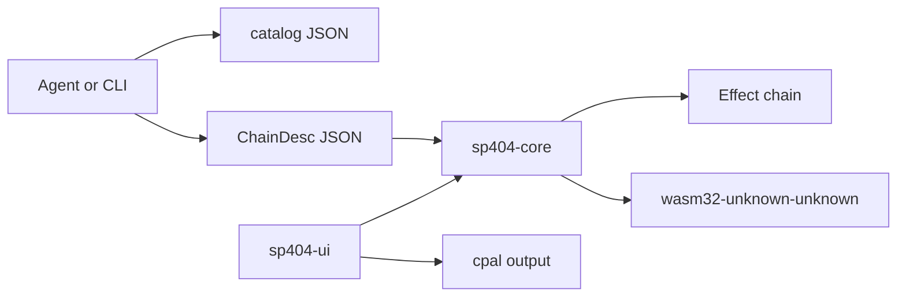

# Pad404

A small pad sampler in the tradition of the Roland SP-404. It is an independent project, not affiliated with or endorsed by Roland.

The point of the layout is that the sound is a library. The window is only one client. An agent, a CLI, or a future WASM host can discover the same effects, build the same chains, and render the same audio.

## Workspace

| Crate | Role |
| --- | --- |
| `sp404-core` | Effects, chains, the 16-pad engine, offline render, WAV encode/decode. No threads, devices, or filesystem. |
| `sp404-cli` | `sp404` binary. Prints the catalog and renders a WAV from a chain file. |
| `sp404-ui` | Native egui window and `cpal` output. This is the only crate that talks to the sound device. |



## Architecture

### An effect is a unit with a schema

Every processor implements [`Effect`](crates/sp404-core/src/effect.rs). It owns its state, takes interleaved stereo `f32` in place, and exposes parameters by string id. The ids, ranges, units, curves, and defaults live on a static [`EffectSchema`](crates/sp404-core/src/param.rs), not in the UI.

```rust
pub trait Effect: Send {
    fn schema(&self) -> &'static EffectSchema;
    fn process(&mut self, samples: &mut [f32], sample_rate: f32);
    fn set_param(&mut self, id: &str, value: f32) -> Result<(), Error>;
    fn param(&self, id: &str) -> Option<f32>;
    fn set_bypassed(&mut self, bypassed: bool);
    fn is_bypassed(&self) -> bool;
    fn reset(&mut self);
}
```

Stored values are always in real units (hertz, decibels, milliseconds, semitones). `scale` is only a hint for a slider: `linear`, `logarithmic`, or `choice`. Out-of-range finite values are clamped. Unknown ids and non-finite values return an error, so a bad chain fails loudly instead of drifting.

The built-in set, each in its own module under `crates/sp404-core/src/effects/`:

| Id | What it does |
| --- | --- |
| `gain` | Level in dB. 0 dB is unity. |
| `filter` | Resonant state-variable low-pass, band-pass, or high-pass. |
| `isolator` | Three-band isolator. 0 dB on every band reconstructs the input. |
| `compressor` | Stereo-linked compressor with a soft knee. Ratio 1 is unity. |
| `lofi` | Bit depth and sample-and-hold rate reduction. |
| `vinyl` | Wow, flutter, crackle, and wear. Zero amounts are unity. |
| `pitch` | Dual-grain delay-line pitch shift. 0 semitones is unity. |
| `delay` | Stereo delay, feedback tone, ping-pong crossfeed. |
| `reverb` | Eight damped combs into four all-passes, per channel. |

Bypass is a hard bypass: the buffer is left unchanged. Mix-at-zero and the unity settings above are also identity, and the tests lock that in. Feedback paths flush denormal state so a long tail cannot stall the CPU.

### Chains are data

Effects compose by sitting in series. [`EffectChain`](crates/sp404-core/src/chain.rs) is the live series. [`ChainDesc`](crates/sp404-core/src/chain.rs) is the portable description:

```json
{
  "effects": [
    { "effect": "lofi", "params": { "bit_depth": 6, "downsample": 3, "mix": 1.0 } },
    { "effect": "delay", "params": { "time_ms": 180, "feedback": 0.35, "mix": 0.3 } }
  ]
}
```

A bare JSON array of effect objects is accepted too. `id` and `kind` are aliases of `effect`. Omitted parameters keep the schema default. `bypass: true` leaves the slot in the chain but skips it.

The same description drives a pad insert, the bus, the CLI, and `render` / `render_json`. Parameter edits call `set_param` on the live effect, so a delay or reverb tail survives a slider move. Adding, removing, or reordering rebuilds the chain.

Ready-made chains live in [`examples/chains/`](examples/chains) and are embedded in the library as presets, so a wasm build does not need the files on disk.

### How an agent discovers and renders

No MCP server is included. The surface it would wrap is already stable and JSON-shaped.

1. **Discover.** `sp404 catalog` (or `sp404_core::catalog_json()`) returns one document: `version`, every effect schema, and the presets. Each parameter has `id`, `name`, `description`, `unit`, `min`, `max`, `default`, `scale`, and `choices`.
2. **Inspect one effect.** `sp404 schema filter`.
3. **Compose.** Write a `ChainDesc`. Validate it by instantiating; unknown effects and unknown parameters error.
4. **Render.** `render` / `render_json` run an `AudioBuffer` through the chain and return stereo samples at the same frame count. `encode_wav` turns that into 16-bit WAV bytes. Neither function opens a file or a device.

```bash
sp404 catalog
sp404 render --demo kick --chain examples/chains/dub-delay.json --output kick.wav
```

`--output -` writes the WAV to stdout. `--input file.wav` renders a file instead of a demo. `--sample-rate 48000` resamples first.

From Rust, the same path is `AudioBuffer::demo`, `render_json`, and `encode_wav`. The pad engine is also headless: load samples, `trigger`, and `process`, or pass `NoteEvent`s to `render_performance`.

### Extending the set

Implement `Effect` and either `EffectChain::push` the box, or `Registry::register` it under a schema. A later registration with the same id shadows the built-in, so a host can replace `filter` without changing the JSON shape. `Registry::builtin()` is what the CLI and UI use.

### Sampler

`Engine` holds 16 pads. Each pad has a sample, volume, semitone playback rate, start/end, and an insert chain. Voices sum, then the bus chain runs, then the master gain. The engine is `Send`; share it with a mutex. `prepare` reserves the scratch buffer so the audio callback does not allocate on the first block.

The UI loads a demo bank (kick, snare, hats, toms, bass, and a few tones) so it is playable before any file is dropped. Drop a WAV on a pad, or type a path. WAV reading supports PCM 8/16/24/32-bit and float 32-bit, mono or stereo.

### WASM boundary

`sp404-core` is the wasm crate. It does not use threads, `std::fs`, audio devices, or dialogs. `sp404-cli` and `sp404-ui` are the native edges (`cpal`, the filesystem, the window).

```bash
cargo build -p sp404-core --target wasm32-unknown-unknown
```

A later `wasm-bindgen` wrapper can export `catalog_json`, `render_json`, and `encode_wav` without changing the effect model. The UI is native in this pass; the same engine calls are what a browser shell would make.

## Run

Rust 1.88 or newer.

```bash
cargo test --workspace
cargo run -p sp404-cli -- catalog
cargo run -p sp404-cli -- render --demo kick --chain examples/chains/dub-delay.json --output kick.wav
cargo run -p sp404-ui
```

In the window, keys `1–4`, `Q–R`, `A–F`, `Z–V` trigger the pads. Space retriggers the selected pad. The chain editor targets either that pad or the bus. **Render WAV** bounces the selected pad through its insert chain and the bus to `pad404-padNN.wav`.

If no output device is present, the window still opens and a silent clock keeps the engine running. Render from the CLI to hear a file.

## Tests

`cargo test --workspace` covers:

- bypass and unity settings are identity
- low-pass attenuation, compressor gain reduction, delay time, reverb tail, bitcrush hold and quantization
- parameter clamping, choice snapping, unknown ids, JSON aliases
- catalog ranges and preset instantiation
- no non-finite samples and no denormal blow-ups at parameter extremes
- feedback delay and reverb stay bounded
- WAV round-trip, mono-to-stereo render, pad playback, and a short performance bounce
- a custom effect registered beside the built-ins
- the CLI catalog and a demo render to a WAV file

## Next steps

- MIDI in, and a pattern sequencer that records `NoteEvent`s.
- Record from the input device onto a pad.
- More SP-style processors once the chain format is in use: cassette, a DJ looper, a brickwall limiter.
- Smoothed parameters so automating cutoff does not zipper.
- A `wasm-bindgen` crate and a browser shell over the same `catalog_json` / `render_json` API.
- An MCP server that is a thin wrapper around the catalog and the render functions. The JSON document is already the contract.
