# Pad404

A small pad sampler in the tradition of the Roland SP-404. It is an independent project, not affiliated with or endorsed by Roland.

The point of the layout is that the sound is a library. The window is only one client. An agent, a CLI, or a future WASM host can discover the same effects, build the same chains, and render the same audio.

## Workspace

| Crate | Role |
| --- | --- |
| `sp404-core` | Effects, chains, the 16-pad engine, offline render, WAV encode/decode. No threads, devices, or filesystem. |
| `sp404-cli` | `sp404` binary. Prints the catalog and renders a WAV from a chain or an arrangement. |
| `sp404-ui` | Native egui window and `cpal` output. This is the only crate that talks to the sound device. |

```mermaid
flowchart LR
  agent["Agent or CLI"] --> catalog["catalog JSON"]
  agent --> chain["ChainDesc JSON"]
  agent --> plan["Arrangement JSON"]
  chain --> core["sp404-core"]
  plan --> core
  ui["sp404-ui"] --> core
  core --> effects["Effect chain"]
  ui --> device["cpal output"]
  core --> wasm["wasm32-unknown-unknown"]
```



## Architecture

### An effect is a unit with a schema

Every processor implements [`Effect`](crates/sp404-core/src/effect.rs). It owns its state, takes interleaved stereo `f32` in place, and exposes parameters by string id. The ids, ranges, units, curves, and defaults live on a static [`EffectSchema`](crates/sp404-core/src/param.rs), not in the UI.

```rust
pub trait Effect: Send {
    fn schema(&self) -> &'static EffectSchema;
    fn process(&mut self, samples: &mut [f32], sample_rate: f32);
    fn set_param(&mut self, id: &str, value: f32) -> Result<(), Error>;
    fn param(&self, id: &str) -> Option<f32>;
    fn set_bypassed(&mut self, bypassed: bool);
    fn is_bypassed(&self) -> bool;
    fn reset(&mut self);
}
```

Stored values are always in real units (hertz, decibels, milliseconds, semitones). `scale` is only a hint for a slider: `linear`, `logarithmic`, or `choice`. Out-of-range finite values are clamped. Unknown ids and non-finite values return an error, so a bad chain fails loudly instead of drifting.

The built-in set, each in its own module under `crates/sp404-core/src/effects/`:

| Id | What it does |
| --- | --- |
| `gain` | Level in dB. 0 dB is unity. |
| `filter` | Resonant state-variable low-pass, band-pass, or high-pass. |
| `isolator` | Three-band isolator. 0 dB on every band reconstructs the input. |
| `compressor` | Stereo-linked compressor with a soft knee. Ratio 1 is unity. |
| `lofi` | Bit depth and sample-and-hold rate reduction. |
| `vinyl` | Wow, flutter, crackle, and wear. Zero amounts are unity. |
| `pitch` | Dual-grain delay-line pitch shift. 0 semitones is unity. |
| `delay` | Stereo delay, feedback tone, ping-pong crossfeed. |
| `reverb` | Eight damped combs into four all-passes, per channel. |

Bypass is a hard bypass: the buffer is left unchanged. Mix-at-zero and the unity settings above are also identity, and the tests lock that in. Feedback paths flush denormal state so a long tail cannot stall the CPU.

### Chains are data

Effects compose by sitting in series. [`EffectChain`](crates/sp404-core/src/chain.rs) is the live series. [`ChainDesc`](crates/sp404-core/src/chain.rs) is the portable description:

```json
{
  "effects": [
    { "effect": "lofi", "params": { "bit_depth": 6, "downsample": 3, "mix": 1.0 } },
    { "effect": "delay", "params": { "time_ms": 180, "feedback": 0.35, "mix": 0.3 } }
  ]
}
```

A bare JSON array of effect objects is accepted too. `id` and `kind` are aliases of `effect`. Omitted parameters keep the schema default. `bypass: true` leaves the slot in the chain but skips it.

The same description drives a pad insert, the bus, the CLI, and `render` / `render_json`. Parameter edits call `set_param` on the live effect, so a delay or reverb tail survives a slider move. Adding, removing, or reordering rebuilds the chain.

Ready-made chains live in [`examples/chains/`](examples/chains) and are embedded in the library as presets, so a wasm build does not need the files on disk.

### How an agent discovers and renders

No MCP server is included. The surface it would wrap is already stable and JSON-shaped.

1. **Discover.** `sp404 catalog` (or `sp404_core::catalog_json()`) returns one document: `version`, every effect schema, and the presets. Each parameter has `id`, `name`, `description`, `unit`, `min`, `max`, `default`, `scale`, and `choices`.
2. **Inspect one effect.** `sp404 schema filter`.
3. **Compose.** Write a `ChainDesc`. Validate it by instantiating; unknown effects and unknown parameters error.
4. **Render.** `render` / `render_json` run an `AudioBuffer` through the chain and return stereo samples at the same frame count. `encode_wav` turns that into 16-bit WAV bytes. Neither function opens a file or a device.

```bash
sp404 catalog
sp404 render --demo kick --chain examples/chains/dub-delay.json --output kick.wav
```

`--output -` writes the WAV to stdout. `--input file.wav` renders a file instead of a demo. `--sample-rate 48000` resamples first.

From Rust, the same path is `AudioBuffer::demo`, `render_json`, and `encode_wav`. The pad engine is also headless: load samples, `trigger`, and `process`, or pass `NoteEvent`s to `render_performance`.

### Arrangements are a pure function of time

An [`Arrangement`](crates/sp404-core/src/plan/mod.rs) is the piece itself: which demo or PCM sits on each pad, when each pad fires (seconds or beats at a tempo), the insert and bus chains, and a curve for any parameter. The same document is JSON and a Rust value. [`PlanBuilder`](crates/sp404-core/src/plan/mod.rs) is the in-code way to write one; `Arrangement::to_json` is what an agent diffs.

```rust
use sp404_core::plan::{beats, chain, effect, Ease, Keyframe, PlanBuilder, Target, Track};
use sp404_core::Error;

fn sweep() -> Result<(), Error> {
    let sweep = PlanBuilder::new(44_100, 100.0)
        .duration(beats(4.0))
        .pad_demo(0, "kick")
        .trigger(0, beats(0.0))
        .bus_chain(chain([effect("filter", [("cutoff", 280.0), ("mix", 1.0)])]))
        .automate(
            Target::bus(0, "cutoff"),
            Track::keyframes([
                Keyframe::at(beats(0.0), 280.0),
                Keyframe::at(beats(4.0), 7200.0).ease(Ease::Smooth),
            ]),
        )
        .finish()?;
    let frames = sweep.duration_frames()?;
    let _audio = sweep.render(0, frames)?;
    Ok(())
}
```

Automation is closed form. A keyframe curve, an LFO, and a spring are functions of absolute time: sampling second 1.5 does not depend on having sampled second 1.4. The spring is the analytic damped oscillator released at a time with zero velocity (`bounce` 0 is critically damped), not a simulation stepped from the previous frame. Ease curves are `linear`, `hold`, `smooth`, `in`, `out`, and `in_out`. An LFO is `sine`, `triangle`, `square`, or `hold` (one deterministic value per cycle). Every effect parameter is automatable, and so are pad volume, pad pitch, and the master gain. The catalog says so: each parameter has `"automatable": true`, and `arrangement.tracks` lists the curve kinds.

The audio path is a recurrence. A delay line at frame 10_000 depends on the frames before it, so the output is not a closed form. It is still a pure function of `(plan, frame range)`. The renderer steps one frame at a time: fire the triggers whose rounded frame is this one, evaluate every track at `frame / sample_rate`, then run the engine for that single frame. Caller chunk size never changes the recurrence.

To start at an arbitrary frame, the renderer restores a checkpoint and replays. Checkpoint `C` is the voice positions and effect memory *before* frame `C`, and `C` is always a multiple of 4096 frames (including 0). The snapshot is an exact copy of filter states, envelopes, delay lines, and playback heads. It is derived from the plan, so a cache only saves work. Rendering the whole piece, or arbitrary slices in any order, follows the same per-frame transition and writes the same sample bits.

Feedback effects stay on this one implementation. A delay with feedback is not a lookback over the dry signal; the delayed copy contains the effect's own past. A second stateless formula for the reverb would be a second instrument. Replaying the recurrence from a checkpoint keeps one instrument and makes a later scrub view possible: seek by restoring the nearest checkpoint and replaying at most 4096 frames.

`ChainDesc` is unchanged. A chain file still renders through `sp404 render`. An arrangement composes those chains over time.

### Variations come from a loudness search

`sp404 vary` reads a WAV and proposes loops. It does not listen for melody or lyrics. Every 20 ms it measures loudness. Stretches above the noise floor are phrases. A long stretch is split where the loudness dips, which is where a breath or a rest usually is. Each phrase gets a score from three things: how hard it attacks, how much louder the peaks are than the average, and whether the length is near a few seconds.

`--around 80` does not mean "80 seconds into the last bounce". It means 80 seconds into the file you passed. The score is divided by the distance from that time, so a nearby phrase wins even if another stretch is slightly more active. Omit `--around` and the seed picks among the top few scores.

The seed also picks the slowdown (from 3 to 7 semitones down), the reverb and vinyl amount, and one of four loop shapes: repeat then expand, lead in with the previous phrase, stutter the attack, or overlap the neighbors. The same file and seed always write the same plan.

```bash
sp404 vary take.wav --around 80 --seed 3 --count 4 --output-dir variations
```

That prints the phrases and writes `variation-3.json` through `variation-6.json`, each with a WAV beside it. The plan points at `take.wav` and cuts it with pad start/end, so the core still does not open files. From Rust the same calls are `analyze` and `vary`.

```bash
sp404 plan validate examples/plans/filter-sweep.json
sp404 plan render examples/plans/filter-sweep.json --output sweep.wav
sp404 plan render examples/plans/dub-throw.json --output throw.wav --start-beat 2 --end-beat 4
```

[`examples/plans/filter-sweep.json`](examples/plans/filter-sweep.json) is a four-beat pattern with a low-pass opening across the bar. [`examples/plans/dub-throw.json`](examples/plans/dub-throw.json) keeps the snare delay closed until the last hit, then opens the mix. From Rust, `Arrangement::from_json` and `Arrangement::render(start, end)` are the same calls. Neither opens a file.

### Extending the set

Implement `Effect` and either `EffectChain::push` the box, or `Registry::register` it under a schema. A later registration with the same id shadows the built-in, so a host can replace `filter` without changing the JSON shape. `Registry::builtin()` is what the CLI and UI use.

### Sampler

`Engine` holds 16 pads. Each pad has a sample, volume, semitone playback rate, start/end, and an insert chain. Voices sum, then the bus chain runs, then the master gain. The engine is `Send`; share it with a mutex. `prepare` reserves the scratch buffer so the audio callback does not allocate on the first block.

The UI loads a demo bank (kick, snare, hats, toms, bass, and a few tones) so it is playable before any file is dropped. Drop a WAV on a pad, or type a path. WAV reading supports PCM 8/16/24/32-bit and float 32-bit, mono or stereo.

### Recording

Device capture stays in `sp404-ui`. `sp404-core` only accepts interleaved frames:

```rust
ingest_take(sample_rate, channels, &frames, TakeOptions {
    target_rate: engine.sample_rate(),
    trim_silence: true,
    ..TakeOptions::default()
})?;
engine.load_pad(pad, buffer, "Input")?;
engine.set_pad_range(pad, 0.0, 1.0)?;
```

`ingest_take` maps channels, optionally trims silence, and resamples to the engine rate. One channel is copied to both sides. Two or more channels keep the first pair. A take that is entirely under the trim threshold (default `0.002`) is kept whole. Non-finite samples become zero. The same call records a resample: pass the interleaved stereo from `Engine::process` (the UI does this from the output callback, or from the silent clock when no output device is present).

In the window, select a pad and open **Record** in the inspector.

- **Input** lists capture devices from `cpal` and selects the host default. **Refresh** re-reads the list. The level meter follows the open input even while idle. **Record** / **Stop** commits the take onto that pad, resampling if the device rate differs. A missing device or a permission error is shown in the panel; the window stays open.
- **Resample** records the engine master (pads, bus, master gain) back onto the pad.
- **Auto-trim silence** drops leading and trailing quiet, keeping a short pre-roll and post-roll.
- Takes stop at 60 seconds. **Save WAV** writes the pad sample (not the effected bounce) to `pad404-take-NN.wav`.

On macOS, a binary from `cargo run` has no `Info.plist`, so the system attributes microphone permission to the app that launched cargo (Terminal, iTerm, Cursor). Grant it under System Settings → Privacy & Security → Microphone. `NSMicrophoneUsageDescription` is only required once the sampler is bundled as an `.app`. A permission denial from the host is surfaced with that note.

A saved take is a normal WAV. Point a plan at it and the CLI inlines the file before rendering. Paths are relative to the plan file:

```json
{ "pad": 0, "sample": { "kind": "file", "path": "pad404-take-01.wav" } }
```

The core validates the path and refuses to open it, which keeps `wasm32` free of filesystem calls. `sp404 plan validate` and `sp404 plan render` resolve the path, decode the WAV, and replace the source with inline PCM.

### WASM boundary

`sp404-core` is the wasm crate. It does not use threads, `std::fs`, audio devices, or dialogs. `sp404-cli` and `sp404-ui` are the native edges (`cpal`, the filesystem, the window).

```bash
cargo build -p sp404-core --target wasm32-unknown-unknown
```

A later `wasm-bindgen` wrapper can export `catalog_json`, `render_json`, `encode_wav`, and `ingest_take` without changing the effect model. The UI is native in this pass; the same engine calls are what a browser shell would make.

A browser build does not link `cpal`. `getUserMedia({ audio: true })` yields a `MediaStream`. An AudioWorklet (or a `ScriptProcessorNode`) copies each render quantum into an interleaved `Float32` buffer and posts `{ channels, sampleRate, samples }` to the wasm host. The host calls `ingest_take` with `target_rate` set to `engine.sample_rate()`, then `Engine::load_pad`. Recording the master is the same ingest of the interleaved stereo from `Engine::process`. Device enumeration, the permission prompt, and the level meter stay in the page. No core change is required.

## Run

Rust 1.88 or newer.

```bash
cargo test --workspace
cargo run -p sp404-cli -- catalog
cargo run -p sp404-cli -- render --demo kick --chain examples/chains/dub-delay.json --output kick.wav
cargo run -p sp404-cli -- plan render examples/plans/filter-sweep.json --output sweep.wav
cargo run -p sp404-ui
```

In the window, keys `1–4`, `Q–R`, `A–F`, `Z–V` trigger the pads. Space retriggers the selected pad. The chain editor targets either that pad or the bus. **Record** arms the selected pad from the input device or from the engine master; **Save WAV** writes that sample to `pad404-take-NN.wav`. **Render WAV** bounces the selected pad through its insert chain and the bus to `pad404-padNN.wav`.

If no output device is present, the window still opens and a silent clock keeps the engine running. Render from the CLI to hear a file.

## Tests

`cargo test --workspace` covers:

- bypass and unity settings are identity
- low-pass attenuation, compressor gain reduction, delay time, reverb tail, bitcrush hold and quantization
- parameter clamping, choice snapping, unknown ids, JSON aliases
- catalog ranges and preset instantiation
- no non-finite samples and no denormal blow-ups at parameter extremes
- feedback delay and reverb stay bounded
- WAV round-trip, mono-to-stereo render, pad playback, and a short performance bounce
- a custom effect registered beside the built-ins
- the CLI catalog and a demo render to a WAV file
- arrangement JSON round-trips, and bad plans fail validation
- a plan can name a WAV with `{ "kind": "file", "path" }`; the CLI inlines it, and a missing file fails validation
- recorded buffers: channel mapping, resampling, silence trim, non-finite samples, and loading the result onto a pad
- the UI capture path appends only while armed, caps a take at 60 seconds, and a resample through the session clock becomes a pad sample
- effect memory snapshots restore bit-exactly
- `render(plan, start..end)` matches a full render for fresh chunking, cursor chunking, checkpoint boundaries, and random slices in shuffled order
- phrase search ranks a louder burst above a quieter one, `--around` selects the nearby phrase, and the same seed rebuilds the same plan

## Next steps

- A scrub view in the UI on `PlanRenderer`: the checkpoints are already the seek index.
- MIDI in, and recording a performance back into an arrangement.
- A browser shell that posts `getUserMedia` blocks into `ingest_take`.
- More SP-style processors once the chain format is in use: cassette, a DJ looper, a brickwall limiter.
- Smoothed parameters on the live UI. Arrangement automation is already evaluated per frame.
- A `wasm-bindgen` crate and a browser shell over the same `catalog_json` / `render_json` API.
- An MCP server that is a thin wrapper around the catalog and the render functions. The JSON document is already the contract.
